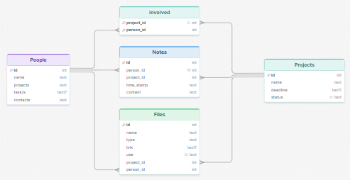
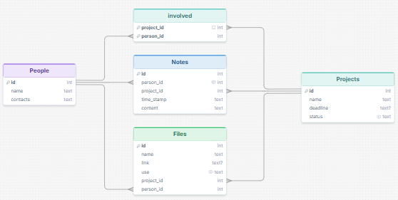
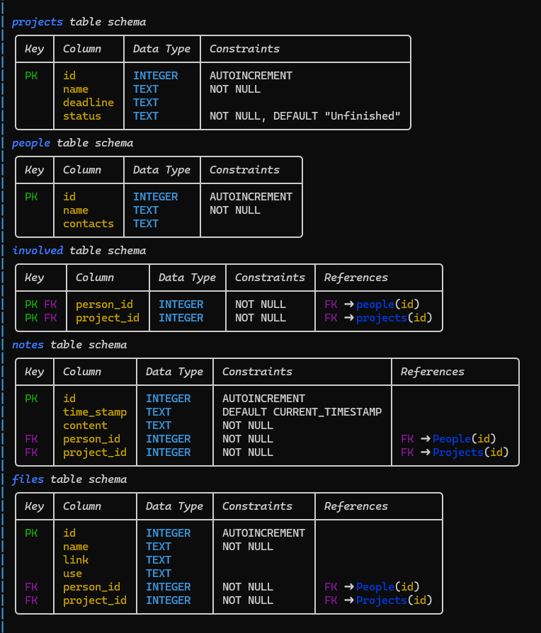
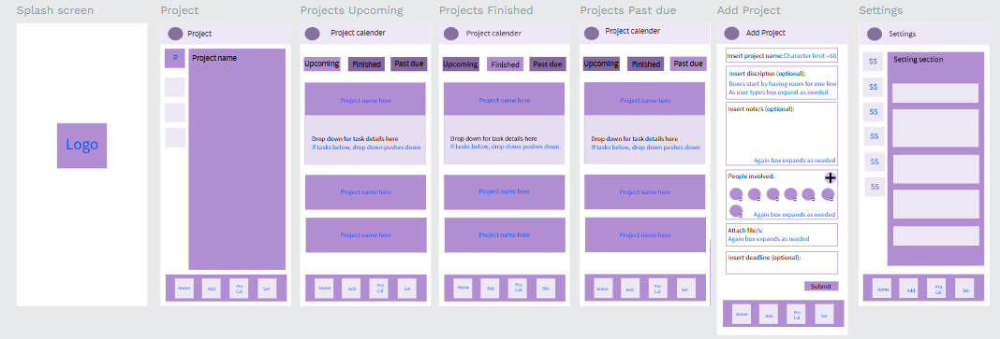
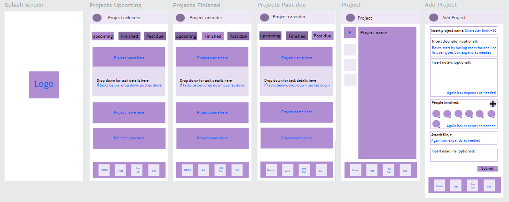

# Sprint 2 - Implement Database and Display of Test Data

## Sprint Goals

Implement the database, populated with test data. Create queries that retrieve test data, and display this on web pages as needed. Test and refine the queries and data display, so that it stands as the basis of the next sprint.

### Specific Goals

I must
Implement the database, Add test data to the database, Make page universal nav,
Create the following web pages:
- Splash screen showing placeholder logo.
- Home screen showing new activity, projects.
- Expanded project with details.
- Project calendar showing upcoming projects.
- Project calendar showing finished projects.
- Project calendar showing past-due projects.
- Add project page showing form.
- Settings page with options.

Develop SQL database queries to:
- Retrieve all upcoming projects
- Retrieve all finished projects
- Retrieve all past-due projects
- Retrieve all new activity
- Retrieve all project information

## Small update

I realized while adding test data to the data base that I forgot to add a "content" felid in the table, so the note actually contains a note!

Updated table:

## Small update

I realized that having "tasks" table was unnecessary, as who is in charge of what can be conveyed through the projects "notes", my user agreed to this and I updated the tables accordingly.
I showed this to my end-user because I thought the felid "Type" was unessisary (this is something I implemented, not asked by the user) they agreed.

Updated table:

## Testing Database
I set up the tables

Then inserted test data to see how they worked.

## Creating pages

My cliant was unsure about the nessesity of the "home page", so I first developed the other pages so they could see what the site would look like without it, after some disscussion they decided the home page didnt serve much purpose, and they would perfer the app opens straight to the upcoming projects calander.

I agreed to this idea, I think this could increase productivity while using the app, seen users can get where they want to go quicker.

## Sprint Review

## Small update

My cliant originally mentioned wanting a settings page, however they think that for personal use this website will be that it would be unessisary, and they would only do such a thing if they wanted to develop the app for public use, so they asked me to remove it.

I agreed with them and removed it.

Through breif development of my end users app we were able to understand what they actaully wanted out of the app before I developed it too far, I think communicating with my user this way was very good as I didnt waste time making pages they would later not want.
